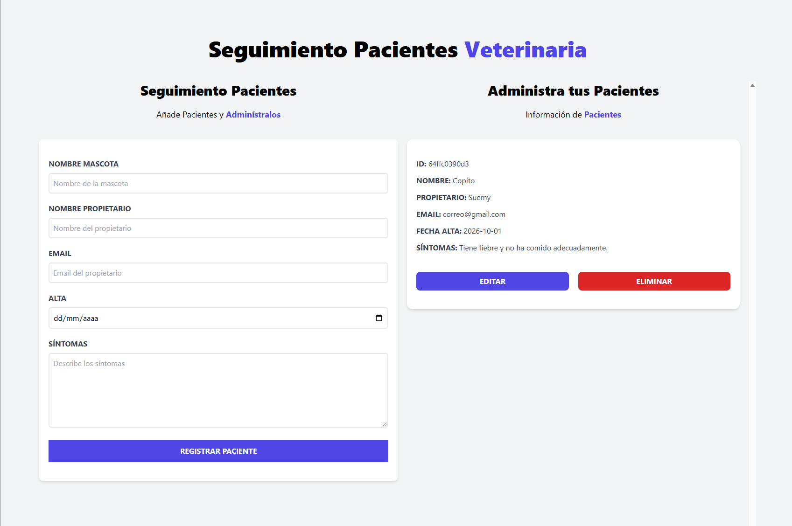

# 🐾 Seguimiento de Pacientes – Veterinaria

Aplicación web para llevar el registro de los pacientes de una veterinaria. Permite dar de alta mascotas con los datos de su propietario y sus síntomas, consultarlas en un listado y editarlas o eliminarlas cuando haga falta.

Está construida con **Vue 3**, **Vite** y **Tailwind CSS**, y guarda la información en el **LocalStorage** del navegador, por lo que no necesita backend ni base de datos.



## ✨ Características

- **Registrar pacientes** con nombre de la mascota, nombre del propietario, email, fecha de alta y síntomas.
- **Editar pacientes**: al presionar *Editar*, el formulario se llena con sus datos y el botón cambia a *Guardar Cambios*.
- **Eliminar pacientes** del listado.
- **Validación del formulario**: todos los campos son obligatorios, con alertas de error y de éxito.
- **Identificador único** para cada paciente, generado automáticamente.
- **Persistencia con LocalStorage**: los datos se conservan al recargar o cerrar el navegador.
- **Diseño responsivo**: en pantallas grandes el formulario y el listado se muestran lado a lado.

## 🛠️ Tecnologías

- [Vue 3](https://vuejs.org/) con Composition API y `<script setup>`
- [Vite](https://vitejs.dev/) como herramienta de desarrollo y build
- [Tailwind CSS](https://tailwindcss.com/) con PostCSS y Autoprefixer
- [uid](https://www.npmjs.com/package/uid) para generar los identificadores
- LocalStorage API del navegador

## 📋 Requisitos

- [Node.js](https://nodejs.org/) 16 o superior
- npm (incluido con Node.js)

## 🚀 Instalación y uso

1. Clona el repositorio:

   ```bash
   git clone https://github.com/SuemyDzib/admin-pacientes.git
   cd admin-pacientes
   ```

2. Instala las dependencias:

   ```bash
   npm install
   ```

3. Inicia el servidor de desarrollo:

   ```bash
   npm run dev
   ```

4. Abre en tu navegador la URL que muestra la terminal (por defecto `http://localhost:5173`).

### Otros scripts

| Comando           | Descripción                                              |
| ----------------- | -------------------------------------------------------- |
| `npm run dev`     | Inicia el servidor de desarrollo con recarga en caliente |
| `npm run build`   | Genera la versión de producción en la carpeta `dist/`    |
| `npm run preview` | Sirve localmente la versión de producción generada       |

## 📖 Cómo se usa

1. Llena el formulario **Seguimiento Pacientes** con los datos de la mascota y su propietario.
2. Presiona **Registrar Paciente**. El paciente aparecerá en el listado de la derecha.
3. Para modificarlo, presiona **Editar** en su tarjeta, cambia los datos y presiona **Guardar Cambios**.
4. Para quitarlo del listado, presiona **Eliminar**.

## 💾 Almacenamiento de datos

Los pacientes se guardan en el LocalStorage del navegador bajo la clave `pacientes`, como un arreglo en formato JSON. Cada paciente tiene esta forma:

```json
{
  "id": "a1b2c3d4e5f",
  "nombre": "Firulais",
  "propietario": "Ana López",
  "email": "ana@correo.com",
  "alta": "2023-02-20",
  "sintomas": "No quiere comer"
}
```

Como los datos viven solo en el navegador, no se sincronizan entre dispositivos y se pierden si se borra el almacenamiento del sitio.